# L2Axis Control — guía paso a paso

Esta guía es para jugadores que **no son programadores**. Va desde la descarga del panel hasta el uso de cada pestaña.
English version: [GUIDE.md](GUIDE.md) · Versão em português: [GUIA.md](GUIA.md).

**Contenido**

1. [Antes de empezar](#1-antes-de-empezar)
2. [Descarga](#2-descarga)
3. [Instalación](#3-instalación)
4. [Primer inicio](#4-primer-inicio)
5. [Clientes: tus ventanas del juego](#5-clientes-tus-ventanas-del-juego)
6. [Login automático](#6-login-automático)
7. [Alertas](#7-alertas)
8. [Eventos](#8-eventos)
9. [Las otras pestañas](#9-las-otras-pestañas)
10. [Actualizar a una versión nueva](#10-actualizar-a-una-versión-nueva)
11. [Problemas y respuestas](#11-problemas-y-respuestas)
12. [Desinstalar](#12-desinstalar)

---

## 1. Antes de empezar

- Una PC con **Windows 10 u 11**.
- El **cliente del juego L2Axis** ya instalado (la carpeta que tiene la carpeta `system` con `l2.exe` adentro).
- Unos 5 minutos.

**¿Es seguro?** El panel es de código abierto: cada línea está en esta página y cualquiera puede leerla. No lee la
memoria del juego, no toca el tráfico de red y no juega por ti. Si tienes dudas, puedes darle los archivos a un
asistente de IA (Claude, ChatGPT…) y pedirle que los revise, o esperar la opinión del staff del servidor en el foro.

## 2. Descarga

1. En la página del proyecto en GitHub, haz clic en el botón verde **Code** y luego en **Download ZIP**.
2. Abre tu carpeta **Descargas**, haz clic derecho en el ZIP y elige **Extraer todo…**.
3. Mueve la carpeta extraída (`L2AxisControl-main`) **dentro de la carpeta de tu cliente de L2Axis**, junto a la carpeta `system`:

```
L2Axis\
├─ system\                 ← el juego (l2.exe está aquí)
└─ L2AxisControl-main\     ← el panel
```

El nombre de la carpeta no importa, solo su lugar: tiene que estar junto a `system`.

## 3. Instalación

1. Abre la carpeta `L2AxisControl-main` y haz doble clic en **`install.bat`**.
2. Si Windows muestra **"Windows protegió su PC"**, haz clic en **Más información → Ejecutar de todas formas**.
   Esto pasa con cualquier archivo descargado de internet. `install.bat` e `install.ps1` son texto plano: puedes
   abrirlos con el Bloc de notas y leerlos antes.
3. Se abre una ventana negra que revisa todo:
   - **Python** — el lenguaje en el que está escrito el panel. Si falta, pregunta (en inglés)
     *"Install Python 3.12 now with winget? (y/n)"*: escribe **y** y presiona Enter.
   - **pywebview** — la única pieza extra que necesita el panel. Se instala sola.
   - **Carpeta** — revisa que el panel esté junto al juego. Si dice `system\l2.exe was not found`, vuelve al paso 2.3.
   - **Accesos directos** — crea **L2Axis Control** en tu Escritorio y en el menú Inicio.
4. Cuando diga que terminó, presiona cualquier tecla para cerrar la ventana.

## 4. Primer inicio

1. Haz doble clic en **L2Axis Control** en tu Escritorio.
2. Windows pregunta *"¿Quieres permitir que esta aplicación haga cambios en el dispositivo?"* — haz clic en **Sí**.
   El juego se ejecuta como administrador, así que el panel necesita los mismos permisos para abrir clientes y escribir el login automático.
   Esta pregunta aparece cada vez que abres el panel.
3. El panel se abre encima de tus otras ventanas.

Lo básico de la ventana:

- **Mover:** arrastra la barra de título.
- **Cambiar el tamaño:** arrastra el borde derecho, el borde inferior o la esquina inferior derecha.
- **▲ (Modo compacto):** muestra solo ping, pérdida y clientes. Haz clic de nuevo para expandir.
- **_ y ✕:** minimizar y cerrar.
- **Idioma:** pestaña Opciones → Panel → PT-BR / EN / DE / ES. Las imágenes de esta guía están en inglés; para ver el panel en español, elige Opciones → Panel → ES.

## 5. Clientes: tus ventanas del juego

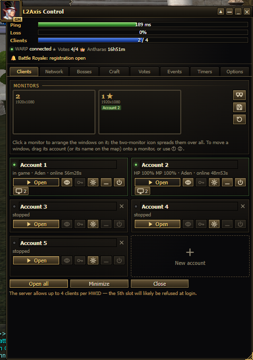

Cada **tarjeta** es una de tus cuentas. Haz clic en el nombre para cambiarlo (el nombre también aparece en el título
de la ventana del juego, lo que ayuda cuando tienes varias abiertas). **+ Nueva cuenta** agrega una tarjeta (hasta 10); **✕** en una tarjeta detenida la quita.

Botones de cada tarjeta:

| Botón | Qué hace |
|---|---|
| **▶ Abrir** | Abre un cliente del juego para esta tarjeta. |
| 👁 (ojo) | Trae esa ventana del juego al frente. |
| 🔑 (llave) | Escribe ahora el login y la contraseña guardados (en la pantalla de login). |
| ⚙ (engranaje) | Configuración de la cuenta: login, contraseña y opciones de login automático. |
| **_** | Minimiza esa ventana del juego. |
| ⏻ (apagar) | Cierra ese cliente (pregunta antes). |

La línea debajo del nombre muestra el estado, por ejemplo `HP 100% MP 85% · Aden · en línea 1h12m`:

- **en el juego / región / en línea** — se lee del archivo de log del propio juego. Funciona con los dos primeros clientes que abras
  (el juego solo escribe log de esos dos).
- **HP / MP** — se lee de las barras de la ventana del juego. Solo mientras la ventana **no está minimizada** (puede estar
  detrás de otras ventanas o en otro monitor).
- **⚠ DESCONECTADO** (rojo) — el cliente perdió la conexión con el servidor.

### Monitores

El **mapa de monitores** muestra tus monitores como están ubicados (★ = monitor principal), con las cuentas que hay en cada uno.

- **Haz clic en un monitor** para organizar todas las ventanas del juego en él, una al lado de la otra.
- **Arrastra una cuenta** (su tarjeta, o su nombre en el mapa) **hacia un monitor** para mover esa ventana allí.
- **Organizar:** botones listos para cada forma de repartir los clientes abiertos entre los monitores (uno por monitor,
  dos lado a lado en un monitor, dos en uno y uno en el otro...). Cada botón dibuja tus monitores con las ventanas; pasa
  el cursor por encima para ver qué cuenta va a qué monitor. La lista cambia sola cuando abres o cierras un cliente, y la
  disposición actual queda resaltada. Aparece con 2 monitores o más.
- Los botones de la derecha: repartir las ventanas en **todos** los monitores, **guardar** la disposición actual,
  **restaurar** la disposición guardada.

El servidor permite hasta **4 clientes por PC (HWID)**; el panel te avisa antes de abrir más.

## 6. Login automático

El panel puede escribir tu login cuando se abre un cliente, e incluso llevarte dentro del juego.

1. En la tarjeta de la cuenta, haz clic en ⚙ (engranaje).
2. Escribe el **Login** y la **Contraseña** (exactamente como los usas en el juego — L2Axis crea una cuenta nueva si el
   login no existe, así que revisa bien cómo lo escribes).
3. Marca **Iniciar sesión automáticamente al abrir desde el panel**.
4. Opcional: marca **Después de iniciar sesión, entrar al juego con el último personaje usado**.
5. Haz clic en **Guardar**.

Desde ahora, **▶ Abrir** en esa tarjeta:

1. espera hasta que aparece el botón **Log In** y escribe el login y la contraseña;
2. espera la lista de servidores y confirma el servidor;
3. se detiene en la selección de personaje — o, si lo marcaste, entra con el último personaje usado.

Una ventanita en la esquina inferior derecha muestra cada paso de cada cuenta (amarillo = en curso, verde = listo,
rojo = falló, con el motivo). Nunca le quita el teclado al juego, así que puedes hacer otras cosas mientras tanto.
En **Opciones → Panel → Login automático** puedes elegir que se detenga en la lista de servidores.

**Tu contraseña** la cifra Windows: solo tu usuario de Windows en esta PC puede leerla. Nunca se vuelve a mostrar en el
panel y nunca sale de tu PC.

## 7. Alertas

El panel emite un pitido y muestra un aviso (arriba en el panel y en la ventanita de la esquina) cuando:

| Alerta | Cuándo |
|---|---|
| **se cayó** | Un cliente perdió la conexión con el servidor y sigue abierto. |
| **se cerró solo** | Un cliente en el juego se cerró sin que tú lo cerraras (crash o desconexión). |
| **murió** | El HP del personaje llegó a 0. |
| **HP al …%** | HP por debajo del 30 %. |
| **MP al …%** | MP por debajo del 10 % (ej. se acabaron las pociones de maná en auto farm). |
| **inscripciones abiertas / empezó** | Un evento del servidor abrió inscripciones o empezó (leído en el chat). |

Cada alerta suena una vez y se vuelve a activar cuando todo vuelve a la normalidad. Las alertas de HP/MP/muerte
necesitan la ventana del juego **sin minimizar**. Puedes desactivar las alertas de HP/MP y de eventos en **Opciones → Panel → Alertas**.

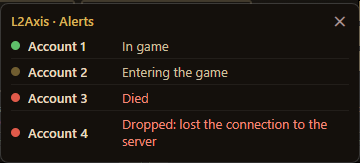

## 8. Eventos

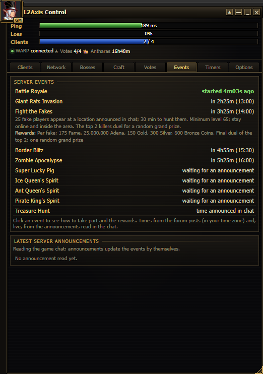

La pestaña **Eventos** lista los eventos del servidor, el más próximo primero:

- la hora del próximo, **ya en tu zona horaria** (el servidor usa GMT+3; el panel la convierte);
- **haz clic en un evento** para ver cómo participar y las recompensas;
- verde = está ocurriendo ahora o tiene inscripciones abiertas.

**Estado en vivo:** mientras uno de tus personajes está en el juego con su ventana **sin minimizar**, el panel lee los
anuncios del servidor en el chat cada pocos segundos (solo los anuncios en cian, nunca los mensajes de jugadores). Con eso
actualiza los eventos solo — inscripciones abiertas, empezó, terminó, cancelado ("not enough players") — y lista los
últimos anuncios abajo.

Los eventos que dependen del reinicio del servidor (Lucky Pig, los Spirits) muestran *esperando un anuncio* hasta que el
panel los ve anunciados una vez; después calcula los siguientes.

## 9. Las otras pestañas

| Pestaña | Uso |
|---|---|
| 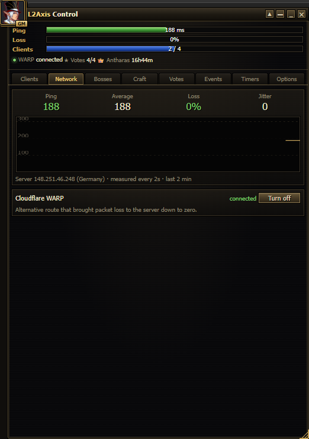 | **Red:** ping y pérdida de paquetes hacia el servidor, un gráfico de 2 minutos y el interruptor de Cloudflare WARP. Si tu ping salta o pierdes paquetes, prueba activar WARP (o desactivarlo). |
| 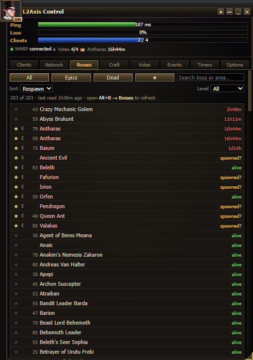 | **Bosses:** cuentas regresivas de respawn. En el juego, abre **Alt+B → Bosses** para actualizarlas. ★ marca favoritos (suena un pitido cuando reaparecen). Necesita un cambio en el cliente que todavía no se publicó; sin él, la lista queda vacía. **🗺 Mapa:** mira más abajo. |
| 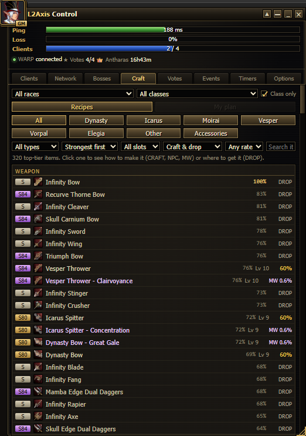 | **Craft:** elige tu raza y tu clase arriba. **Recetas** muestra los ítems top; haz clic en uno para ver el paso a paso, los materiales y dónde dropean. **Mi plan** muestra el mejor ítem para cada slot de tu clase. |
| 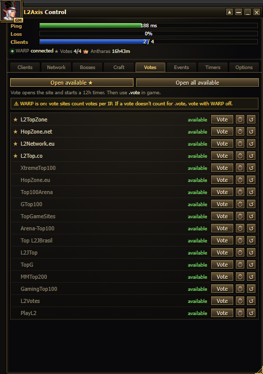 | **Votos:** haz clic en **Votar** en un sitio para abrirlo e iniciar su temporizador de 12 horas. **Abrir disponibles ★** abre los principales. Luego escribe **.vote** en el juego. Vota con WARP/VPN **desactivado**: los sitios de votación revisan tu IP. |
| 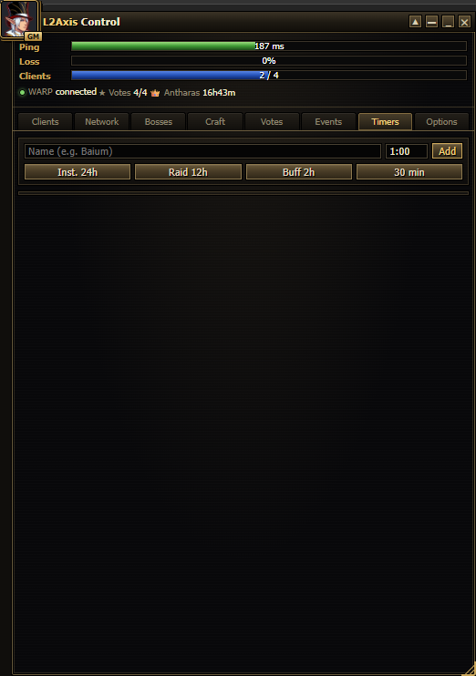 | **Timers:** escribe un nombre y un tiempo (`1:30` = 1 h 30 min) y haz clic en **Agregar**, o usa uno predefinido. Suena un pitido cuando termina. |
| 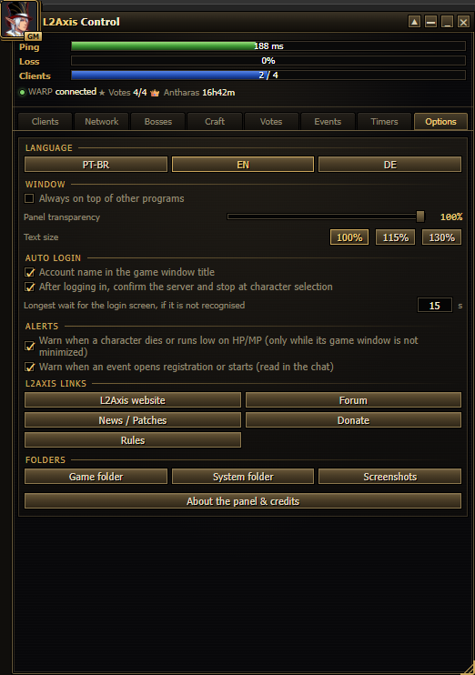 | **Opciones**, en cuatro partes. **Panel:** idioma, siempre encima, transparencia, tamaño del texto, login automático y alertas. **Chat y avisos:** perfiles listos (Original del juego, PvP, Farm, Spoil) para los colores del chat, mensajes cortos y avisos arriba en la pantalla con sonido (skill resistida o esquivada, shots agotados, buff quitado, spoil activado), con una vista previa y **Personalizar** para ajustar cada ítem; se ve la próxima vez que inicies el juego. **Mobs e ítems:** busca un ítem (ej. Steel Mold) y márcalo; los monstruos que lo dan por spoil muestran el título sobre la cabeza (en L2Axis, el "Lv 85*" del servidor) en el color elegido, y el nombre del ítem lleva una marca y el color de los ítems top (se ve rosa/morado). Vaciar la lista y aplicar deja todo como estaba. En **En el objetivo**, "Iconos de Spoil y Drop en el objetivo" le pone al objetivo dos iconos con lo que dice el Alt+B del servidor sobre el monstruo: solo filas exactas que abriste en Alt+B (páginas de ítems en Database), y el texto dice cuántos ítems faltan por conocer. **Enlaces:** enlaces de L2Axis y accesos directos a las carpetas del juego. **Acerca del panel y créditos** muestra los créditos. |

### Mapa de bosses

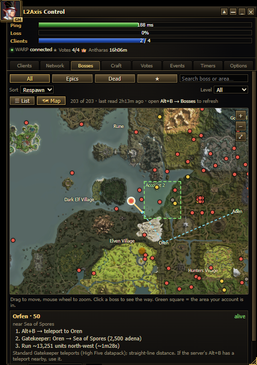

En la pestaña **Bosses**, haz clic en **🗺 Mapa**, en el botón 🗺 de la barra de título, o en **🗺 En el mapa** en los
detalles de un boss. El mapa se abre en un **panel lateral pegado al panel** (la ventana crece hacia el lado; « lo cierra),
con una lista rápida de bosses a la izquierda (con su propia búsqueda) y el mapa a la derecha:

- cada boss es un punto: **rojo** = vivo, **amarillo** = reaparece pronto / quizás apareció, **gris** = muerto; los epics tienen un anillo dorado;
- el **cuadrado verde** es la zona donde está cada una de tus cuentas (el juego solo dice la zona, no el punto exacto);
- los nombres de las zonas vienen de tu juego; acerca el zoom para ver más. **◆** marca los **teleports de Alt+B** del
  servidor (instancias, necrópolis, pisos de la Tower of Insolence…);
- los bosses dentro de la **Tower of Insolence** muestran su **piso** (ej. Cherub Galaxia · piso 13);
- **arrastra** para mover, **rueda del mouse** para el zoom, ⤢ para ver el continente completo;
- **haz clic en un boss** para ver el camino más rápido, dibujado en el mapa (punteado = teleport, continuo = correr) y
  escrito abajo: el **teleport de Alt+B** más cercano (o Alt+B a una ciudad → Gatekeeper) → correr en una dirección, con
  el tiempo, y cuántos pisos subir o bajar en la Tower of Insolence;
- **Desde:** la ciudad donde empiezas (automático = donde está tu cuenta). Desmarca *Usar el teleport de Alt+B a las
  ciudades* si prefieres usar solo Gatekeepers.

La primera vez, el panel arma el mapa con los archivos de tu juego (unos 30 segundos). Las distancias son en línea
recta: el camino real puede ser un poco más largo.

### Spoil

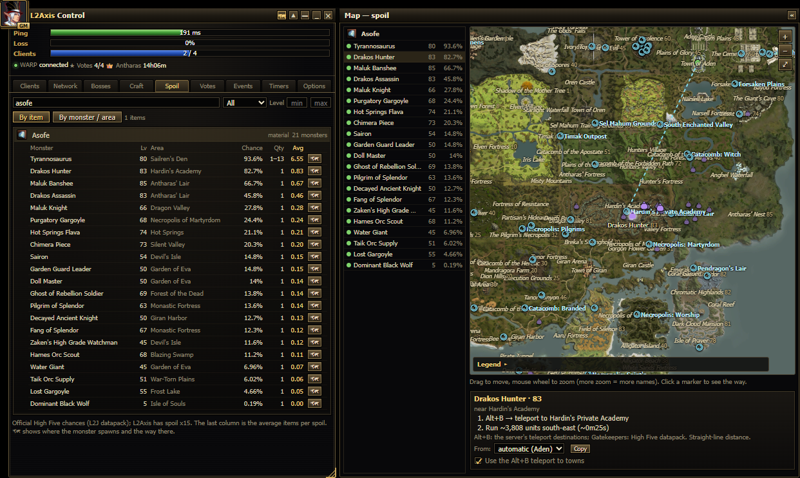

La pestaña **Spoil** es para spoilers (Bounty Hunters / Fortune Seekers):

- **Por ítem:** escribe el ítem que quieres (ej. *Asofe*, *Mithril Ore*, una receta). Haz clic en él para ver cada
  monstruo que lo da, con nivel, zona, probabilidad, cantidad y el **promedio por spoil** (el mejor primero).
- **Por monstruo / zona:** escribe un monstruo o una zona (ej. *Hardin*) para ver qué da cada monstruo de allí.
- **Categorías:** Materiales, Intermedios (materiales que también se craftean), Partes de equipo, Recetas, Enchant,
  Equipo, Tintes y Otros, cada una con su cantidad; recetas, partes y equipo también por **grado** (D … S84). Sin
  búsqueda, la lista se agrupa por categoría: haz clic en un grupo para abrirlo.
- **Nivel del monstruo** min / max deja solo los monstruos que puedes farmear; **ordena** por Mejor promedio, Nombre o Nivel del monstruo.
- Por monstruo, cada fila muestra los iconos de sus mejores spoils.
- **🗺** abre el mapa lateral con los puntos de aparición (◆ verde) de cada monstruo que da ese ítem, y el camino más
  rápido hasta el que elijas. Haz clic en otro punto o en otro monstruo de la izquierda para cambiar.

Las probabilidades vienen de los datos oficiales de High Five y se corrigen con lo que miras en el propio servidor:

- En el juego, **Alt+B > Database** muestra las listas reales de L2Axis (busca por ítem o por monstruo). Con el panel
  abierto, **cada página que abres ahí queda guardada** en el panel, sin ningún clic extra. El panel nunca abre una
  página ni busca por su cuenta: los datos crecen con lo que consultas mientras juegas.
- En la pestaña Spoil, lo que vino del servidor tiene un **✓** y reemplaza la probabilidad de High Five para ese
  monstruo. Los monstruos que solo existen en L2Axis aparecen como *Solo L2Axis* (sin 🗺: el panel no sabe dónde aparecen).
- Las listas de la Database tienen varias páginas. Mientras falten algunas, el ítem dice *Parte de la lista del servidor*;
  cuando ya se vieron todas las páginas (o las filas coinciden con los totales de la búsqueda del ítem), la lista del servidor reemplaza la de High Five.
- Por monstruo, la ficha de la Database también dice si el monstruo es **agresivo**, su HP y sus defensas.
- Abajo, la pestaña muestra cuántos ítems se revisaron y los **Cambios detectados** por el panel (una probabilidad que
  cambió, un monstruo que entró a una lista o salió de ella).
- **Craft > Fuentes** muestra las listas de drop y spoil del servidor antes que los datos de High Five.

En L2Axis, drop, spoil y adena son x8.

## 10. Actualizar a una versión nueva

1. Cierra el panel (✕).
2. Descarga el ZIP nuevo (paso 2) y extráelo.
3. Copia los archivos nuevos **encima** de la carpeta actual del panel y acepta reemplazarlos.
   Tu **`data.json`** (configuración, cuentas, timers) no está en el ZIP, así que se conserva.
4. Si la versión nueva lo indica, ejecuta `install.bat` de nuevo. Luego abre el panel como siempre.

## 11. Problemas y respuestas

**El panel no abre.**
Ábrelo desde el **acceso directo del Escritorio** y responde **Sí** a la pregunta de administrador. Si no aparece nada,
mira `errors.log` en la carpeta del panel y publica las últimas líneas en el tema del foro (no contiene tu contraseña).

**Hay dos paneles abiertos / sigue funcionando después de cerrarlo.**
Cierra los dos con ✕. Si uno queda abierto, finaliza `pythonw.exe` en el Administrador de tareas y abre el acceso directo de nuevo.

**El login automático no escribió nada.**
- Revisa que la cuenta tenga login y contraseña guardados (⚙) y la casilla de login automático marcada.
- El cliente tiene que abrirse con **▶ Abrir** en el panel.
- No minimices la ventana del juego mientras inicia sesión: el panel mira la ventana para encontrar los botones.
  Detrás de otras ventanas no hay problema.
- La ventanita de la esquina dice dónde se detuvo.

**No se ve el HP/MP, o no hay alerta de muerte.**
La ventana del juego está minimizada (un juego minimizado no dibuja nada). Déjala abierta, aunque sea detrás de otras
ventanas o en otro monitor. Si moviste la ventana de estado en el juego, el panel encuentra el lugar nuevo después de que cierres ese cliente una vez.

**Los eventos dicen "esperando un anuncio" / la lista de anuncios está vacía.**
Deja un personaje en el juego con su ventana sin minimizar. El panel solo sabe lo que muestra el chat.

**"El servidor permite hasta 4 clientes por HWID".**
Ese es el límite del servidor. Un 5.º cliente suele ser rechazado en el login.

**Quiero cambiar mi contraseña guardada.**
⚙ en la tarjeta → escribe la contraseña nueva → Guardar. Para quitarla: ⚙ → **Borrar**.

**¿Dónde están mis datos?**
En `data.json`, en la carpeta del panel. No compartas ese archivo: tiene tus logins (las contraseñas van cifradas).

## 12. Desinstalar

1. Cierra el panel.
2. Borra la carpeta del panel (`L2AxisControl-main`).
3. Borra los accesos directos de **L2Axis Control** del Escritorio y del menú Inicio.

Python y pywebview pueden quedarse (otros programas pueden usarlos) o quitarse en **Configuración → Aplicaciones**.
