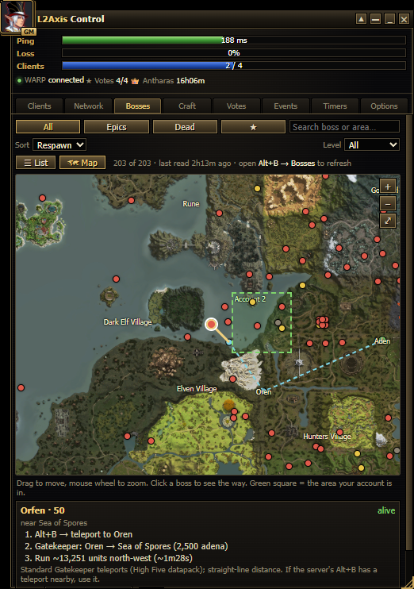
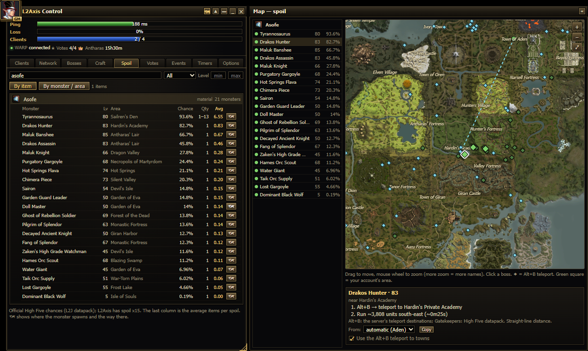

# L2Axis Control — guia passo a passo

Este guia é para quem **não é programador**. Vai do download até o uso de cada aba.
English version: [GUIDE.md](GUIDE.md).

**Conteúdo**

1. [Antes de começar](#1-antes-de-começar)
2. [Download](#2-download)
3. [Instalação](#3-instalação)
4. [Primeira vez](#4-primeira-vez)
5. [Clientes: suas janelas do jogo](#5-clientes-suas-janelas-do-jogo)
6. [Login automático](#6-login-automático)
7. [Avisos](#7-avisos)
8. [Eventos](#8-eventos)
9. [As outras abas](#9-as-outras-abas)
10. [Atualizar para uma versão nova](#10-atualizar-para-uma-versão-nova)
11. [Problemas e respostas](#11-problemas-e-respostas)
12. [Desinstalar](#12-desinstalar)

> As imagens estão em inglês; no painel, escolha **PT-BR** na aba Opções.

---

## 1. Antes de começar

- Um PC com **Windows 10 ou 11**.
- O **jogo do L2Axis** já instalado (a pasta que tem a pasta `system` com o `l2.exe` dentro).
- Uns 5 minutos.

**É seguro?** O painel tem código aberto: cada linha está nesta página e qualquer um pode ler. Ele não lê a memória do
jogo, não mexe no tráfego de rede e não joga por você. Se tiver dúvida, pode entregar os arquivos para uma IA (Claude,
ChatGPT…) e pedir para ela verificar, ou esperar a opinião da equipe do servidor no fórum.

## 2. Download

1. Na página do projeto no GitHub, clique no botão verde **Code** e depois em **Download ZIP**.
2. Abra a pasta **Downloads**, clique com o botão direito no ZIP e escolha **Extrair tudo…**.
3. Mova a pasta extraída (`L2AxisControl-main`) **para dentro da pasta do jogo L2Axis**, ao lado da pasta `system`:

```
L2Axis\
├─ system\                 ← o jogo (o l2.exe fica aqui)
└─ L2AxisControl-main\     ← o painel
```

O nome da pasta não importa, só o lugar: ela tem que ficar ao lado da `system`.

## 3. Instalação

1. Abra a pasta `L2AxisControl-main` e dê dois cliques em **`install.bat`**.
2. Se o Windows mostrar **"O Windows protegeu o computador"**, clique em **Mais informações → Executar assim mesmo**.
   Isso acontece com qualquer arquivo baixado da internet. O `install.bat` e o `install.ps1` são texto puro: dá para
   abrir no Bloco de Notas e ler antes.
3. Abre uma janela preta que confere tudo:
   - **Python** — a linguagem em que o painel foi escrito. Se faltar, ela pergunta
     *"Install Python 3.12 now with winget? (y/n)"*: digite **y** e aperte Enter.
   - **pywebview** — a única peça extra que o painel usa. É instalada sozinha.
   - **Pasta** — confere se o painel está ao lado do jogo. Se aparecer `system\l2.exe was not found`, volte ao passo 2.3.
   - **Atalhos** — cria o **L2Axis Control** na Área de Trabalho e no Menu Iniciar.
4. Quando terminar, aperte qualquer tecla para fechar a janela.

## 4. Primeira vez

1. Dê dois cliques em **L2Axis Control** na Área de Trabalho.
2. O Windows pergunta *"Deseja permitir que este aplicativo faça alterações no seu dispositivo?"* — clique em **Sim**.
   O jogo roda como administrador, então o painel precisa do mesmo para abrir clients e digitar o login automático.
   Essa pergunta aparece toda vez que você abre o painel.
3. O painel abre por cima das outras janelas.

Básico da janela:

- **Mover:** arraste pela barra de título.
- **Tamanho:** arraste a borda direita, a de baixo ou o canto inferior direito.
- **▲ (compacto):** mostra só ping, perda e clientes. Clique de novo para expandir.
- **_ e ✕:** minimizar e fechar.
- **Idioma:** aba Opções → PT-BR / EN / DE.

## 5. Clientes: suas janelas do jogo


Cada **cartão** é uma conta sua. Clique no nome para renomear (o nome aparece também no título da janela do jogo, o
que ajuda quando há várias abertas). **+ Nova conta** adiciona um cartão (até 10); o **✕** num cartão parado remove.

Botões de cada cartão:

| Botão | O que faz |
|---|---|
| **▶ Abrir** | Abre um client do jogo para este cartão. |
| 👁 (olho) | Traz aquela janela do jogo para a frente. |
| 🔑 (chave) | Digita agora o login e a senha salvos (na tela de login). |
| ⚙ (engrenagem) | Configurar a conta: login, senha e opções do login automático. |
| **_** | Minimiza aquela janela do jogo. |
| ⏻ (desligar) | Fecha aquele client (pergunta antes). |

A linha embaixo do nome mostra o estado, por exemplo `HP 100% MP 85% · Aden · online 1h12m`:

- **no jogo / região / online** — lido do arquivo de log do próprio jogo. Funciona para os dois primeiros clients
  abertos (o jogo só grava log desses dois).
- **HP / MP** — lido das barras da janela do jogo. Só com a janela **não minimizada** (pode estar atrás de outras
  janelas ou em outro monitor).
- **⚠ DESCONECTADO** (vermelho) — o client perdeu a conexão com o servidor.

### Monitores

O **mapa de monitores** mostra seus monitores na posição real (★ = monitor principal), com as contas que estão em cada um.

- **Clique num monitor** para organizar lado a lado todas as janelas do jogo nele.
- **Arraste uma conta** (o cartão, ou o nome dela no mapa) **até um monitor** para levar aquela janela para lá.
- Os botões à direita: espalhar as janelas por **todos** os monitores, **salvar** a posição atual, **restaurar** a
  posição salva.

O servidor aceita até **4 clients por PC (HWID)**; o painel avisa antes de abrir mais.

## 6. Login automático

O painel pode digitar o seu login quando um client abre, e até te levar para dentro do jogo.

1. No cartão da conta, clique em ⚙ (engrenagem).
2. Digite o **login** e a **senha** (exatamente como você usa no jogo — o L2Axis cria uma conta nova se o login não
   existir, então confira a digitação).
3. Marque **Logar automaticamente ao abrir pelo painel**.
4. Opcional: marque **Depois do login, entrar no jogo com o último personagem usado**.
5. Clique em **Salvar**.

A partir daí, o **▶ Abrir** daquele cartão:

1. espera o botão **Log In** aparecer e digita login e senha;
2. espera a lista de servidores e confirma o servidor;
3. para na seleção de personagem — ou, se você marcou, entra com o último personagem usado.

Uma janelinha no canto inferior direito mostra cada etapa de cada conta (amarelo = andando, verde = pronto,
vermelho = falhou, com o motivo). Ela nunca tira o teclado do jogo, então dá para mexer em outras coisas enquanto isso.
Em **Opções → Login automático** dá para escolher parar na lista de servidores.

**Sua senha** fica criptografada pelo Windows: só o seu usuário do Windows neste PC consegue abrir. Ela nunca mais
aparece no painel e nunca sai do seu PC.

## 7. Avisos

O painel apita e mostra um aviso (no topo do painel e na janelinha do canto) quando:

| Aviso | Quando |
|---|---|
| **caiu** | Um client perdeu a conexão com o servidor e continuou aberto. |
| **fechou sozinho** | Um client que estava no jogo fechou sem você fechar (travou ou caiu). |
| **morreu** | O HP do personagem chegou a 0. |
| **HP em …%** | HP abaixo de 30 %. |
| **MP em …%** | MP abaixo de 10 % (por exemplo, acabou a poção de mana no auto farm). |
| **inscrições abertas / começou** | Um evento do servidor abriu inscrição ou começou (lido no chat). |

Cada aviso aparece uma vez e só volta depois que tudo normalizar. Os avisos de HP/MP/morte precisam da janela do jogo
**não minimizada**. Dá para desligar os avisos de HP/MP e de eventos em **Opções → Avisos**.


## 8. Eventos


A aba **Eventos** lista os eventos do servidor, o mais próximo primeiro:

- o horário do próximo, **já no seu fuso** (o servidor usa GMT+3; o painel converte);
- **clique num evento** para ver como participar e as recompensas;
- verde = acontecendo agora ou com inscrição aberta.

**Status ao vivo:** enquanto um personagem seu estiver no jogo com a janela **não minimizada**, o painel lê os anúncios
do servidor no chat a cada poucos segundos (só os anúncios em ciano, nunca as mensagens dos jogadores). Com isso ele
atualiza os eventos sozinho — inscrições abertas, começou, terminou, cancelado ("not enough players") — e lista os
últimos anúncios embaixo.

Os eventos que dependem do restart do servidor (Lucky Pig, Spirits) mostram *aguardando anúncio* até o painel ver o
anúncio deles uma vez; depois disso ele calcula os próximos.

## 9. As outras abas

| Aba | Para que serve |
|---|---|
|  | **Rede:** ping e perda de pacotes até o servidor, um gráfico de 2 minutos e o botão do Cloudflare WARP. Se o ping pular ou houver perda, teste o WARP ligado (ou desligado). |
|  | **Bosses:** contagem até o respawn. No jogo, abra **Alt+B → Bosses** para atualizar. A ★ marca favoritos (apita quando nascem). Precisa de uma alteração no client que ainda não foi publicada; sem ela a lista fica vazia. **🗺 Mapa:** veja abaixo. |
|  | **Craft:** escolha raça e classe no topo. **Receitas** lista os itens top; clique num para ver o passo a passo, os materiais e onde dropam. **Meu plano** mostra o melhor item de cada slot para a sua classe. |
|  | **Votos:** clique em **Votar** num site para abrir e iniciar o timer de 12 h. **Abrir ★ disponíveis** abre os principais. Depois digite **.vote** no jogo. Vote com o WARP/VPN **desligado**: os sites conferem o seu IP. |
|  | **Timers:** digite um nome e um tempo (`1:30` = 1 h 30 min, ou só minutos) e clique em **Adicionar**, ou use um atalho pronto. Apita quando acaba. |
|  | **Opções:** idioma, sempre no topo, transparência, tamanho do texto, login automático e avisos, links do L2Axis e atalhos para as pastas do jogo. **Sobre** mostra os créditos. |

### Mapa dos bosses



Na aba **Bosses**, clique em **🗺 Mapa**, no botão 🗺 da barra de título, ou em **🗺 Ver no mapa** nos detalhes de um
boss. O mapa abre numa **janela lateral acoplada ao painel** (a janela cresce para o lado; o « fecha), com uma lista
rápida de bosses à esquerda (com busca própria) e o mapa à direita:

- cada boss é um ponto: **vermelho** = vivo, **amarelo** = nascendo logo / talvez nasceu, **cinza** = morto; os épicos têm um anel dourado;
- o **quadrado verde** é a região onde cada conta sua está (o jogo só informa a região, não o ponto exato);
- os nomes das regiões vêm do seu jogo; dê zoom para ver mais. O **◆** marca os **teleportes do Alt+B** do servidor
  (instâncias, necrópoles, andares da Tower of Insolence…);
- os bosses dentro da **Tower of Insolence** mostram o **andar** (ex.: Cherub Galaxia · 13º andar);
- **arraste** para mover, **roda do mouse** para zoom, ⤢ para ver o continente inteiro;
- **clique num boss** para ver o caminho mais rápido, desenhado no mapa (pontilhado = teleporte, linha cheia = corrida)
  e escrito embaixo: o **teleporte do Alt+B** mais próximo (ou Alt+B para uma cidade → Gatekeeper) → correr numa
  direção, com o tempo e quantos andares subir ou descer na Tower of Insolence;
- **Saindo de:** a cidade de onde você sai (automático = onde sua conta está). Desmarque *Usar o teleporte do Alt+B
  para as cidades* se preferir só Gatekeepers.

Na primeira vez o painel monta o mapa a partir dos arquivos do seu jogo (uns 30 segundos). As distâncias são em linha
reta: o caminho real pode ser um pouco maior.

### Spoil



A aba **Spoil** é para quem faz spoil (Bounty Hunter / Fortune Seeker):

- **Por item:** digite o item que você quer (ex.: *Asofe*, *Mithril Ore*, uma receita). Clique nele para ver todos os mobs
  que dão esse item, com nível, área, chance, quantidade e a **média por spoil** (os melhores primeiro).
- **Por mob / área:** digite um mob ou uma área (ex.: *Hardin*) para ver o que cada mob dali dá.
- **Nível min / max** deixa só os mobs que você consegue farmar. *Materiais / Receitas* filtra a lista.
- **🗺** abre o mapa lateral com os pontos de spawn (◆ verde) de todos os mobs que dão aquele item, e o caminho mais
  rápido até o escolhido. Clique em outro ponto ou em outro mob à esquerda para trocar.

As chances são as oficiais do High Five; o L2Axis tem spoil x15, então use para comparar os mobs entre si.

## 10. Atualizar para uma versão nova

1. Feche o painel (✕).
2. Baixe o ZIP novo (passo 2) e extraia.
3. Copie os arquivos novos **por cima** da pasta atual do painel e aceite substituir.
   O seu **`data.json`** (configurações, contas, timers) não vem no ZIP, então ele é mantido.
4. Se a versão nova pedir, rode o `install.bat` de novo. Depois abra o painel normalmente.

## 11. Problemas e respostas

**O painel não abre.**
Abra pelo **atalho da Área de Trabalho** e responda **Sim** à pergunta de administrador. Se nada aparecer, veja o
`errors.log` na pasta do painel e poste as últimas linhas no tópico do fórum (ele não tem a sua senha).

**Ficaram dois painéis abertos / ele continua rodando depois de fechar.**
Feche os dois no ✕. Se algum ficar, encerre o `pythonw.exe` no Gerenciador de Tarefas e abra o atalho de novo.

**O login automático não digitou nada.**
- Confira se a conta tem login e senha salvos (⚙) e a caixa do login automático marcada.
- O client tem que ser aberto pelo **▶ Abrir** do painel.
- Não minimize a janela do jogo enquanto ele loga: o painel olha a janela para achar os botões.
  Atrás de outras janelas pode.
- A janelinha do canto diz onde parou.

**HP/MP não aparecem, ou não avisou a morte.**
A janela do jogo está minimizada (jogo minimizado não desenha nada). Deixe aberta, mesmo atrás de outras janelas ou em
outro monitor. Se você mudou a janela de status de lugar no jogo, o painel acha o lugar novo depois que você fechar
aquele client uma vez.

**Os eventos dizem "aguardando anúncio" / a lista de anúncios está vazia.**
Deixe um personagem no jogo com a janela não minimizada. O painel só sabe o que o chat mostra.

**"O servidor permite até 4 clientes por HWID".**
É o limite do servidor. Um 5º client normalmente é recusado no login.

**Quero trocar a senha salva.**
⚙ no cartão → digite a senha nova → Salvar. Para apagar: ⚙ → **Apagar**.

**Onde ficam os meus dados?**
No `data.json`, na pasta do painel. Não compartilhe esse arquivo: ele tem os seus logins (senhas criptografadas).

## 12. Desinstalar

1. Feche o painel.
2. Apague a pasta do painel (`L2AxisControl-main`).
3. Apague os atalhos **L2Axis Control** da Área de Trabalho e do Menu Iniciar.

O Python e o pywebview podem ficar (outros programas podem usar) ou ser removidos em **Configurações → Aplicativos**.
