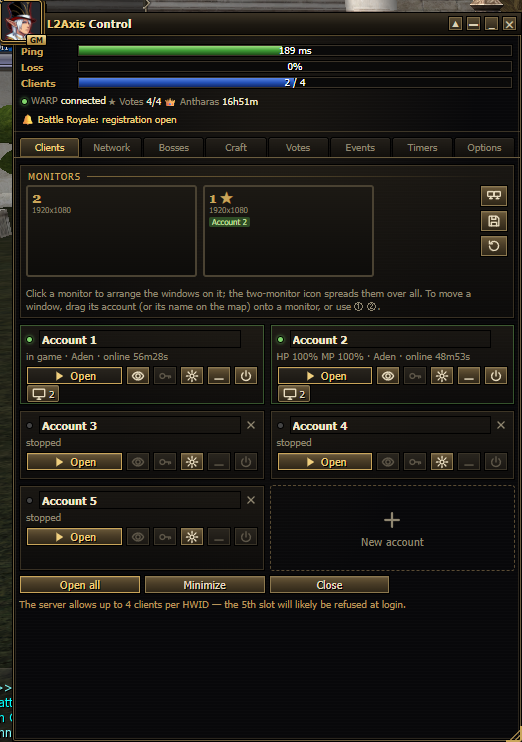
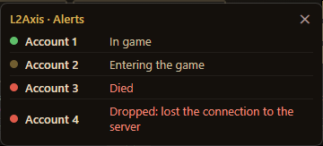
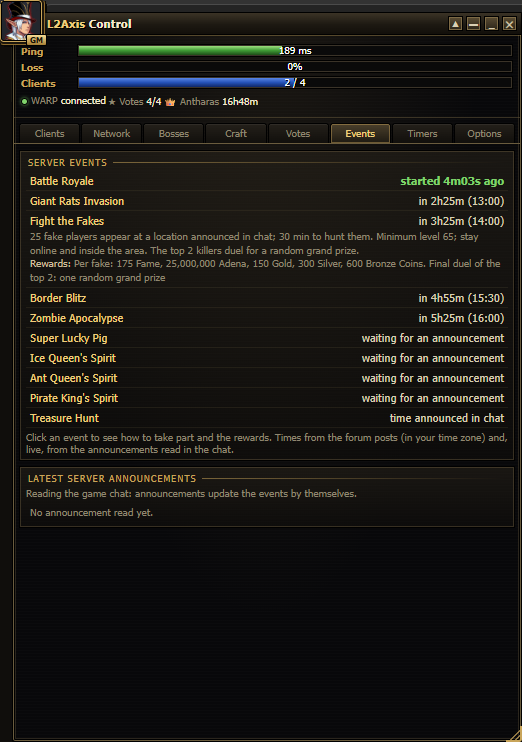
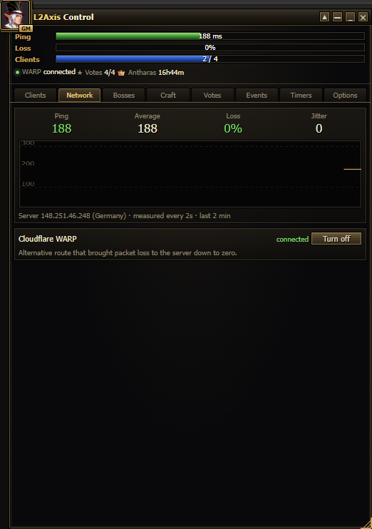
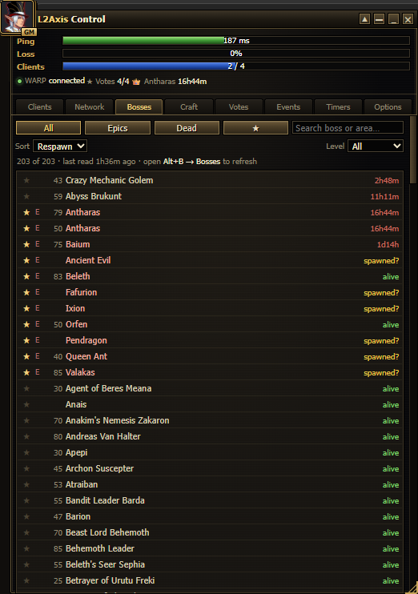
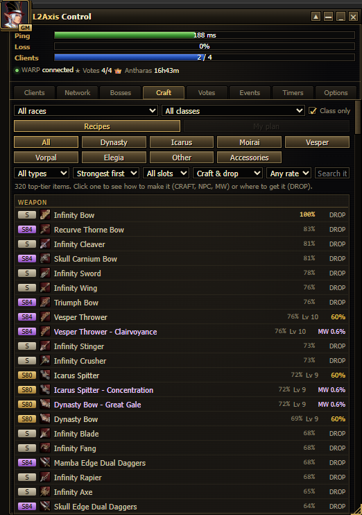
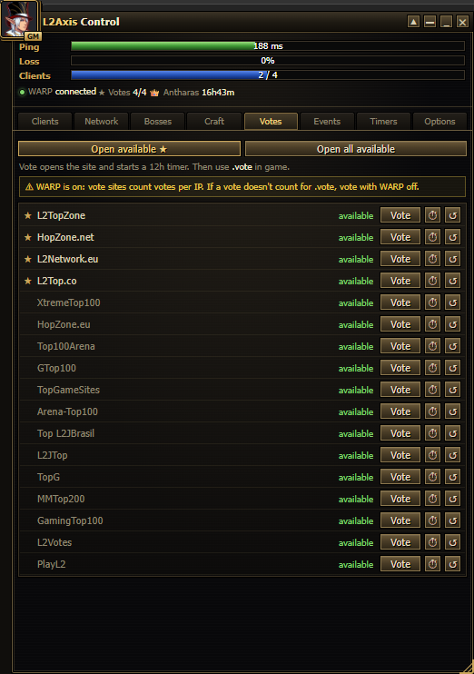
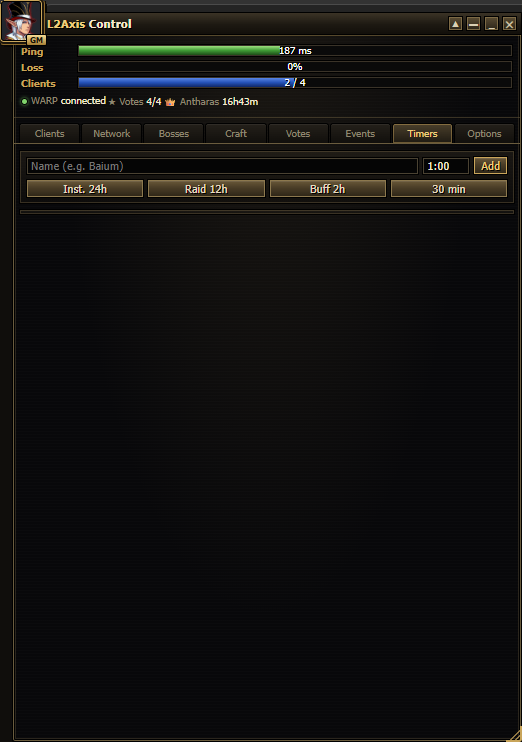
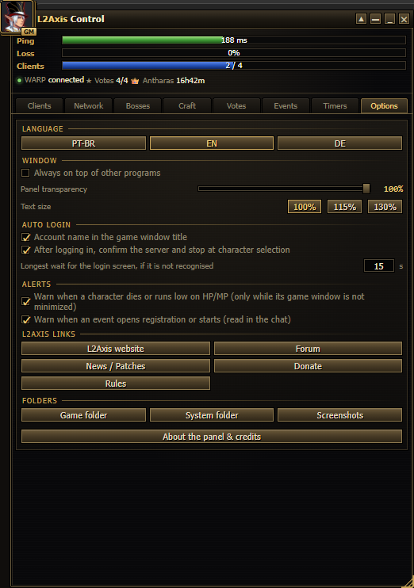

# L2Axis Control — step-by-step guide

This guide is for players who are **not programmers**. It goes from downloading the panel to using every tab.
Versão em português: [GUIA.md](GUIA.md).

**Contents**

1. [Before you start](#1-before-you-start)
2. [Download](#2-download)
3. [Install](#3-install)
4. [First start](#4-first-start)
5. [Clients: your game windows](#5-clients-your-game-windows)
6. [Auto-login](#6-auto-login)
7. [Alerts](#7-alerts)
8. [Events](#8-events)
9. [The other tabs](#9-the-other-tabs)
10. [Updating to a new version](#10-updating-to-a-new-version)
11. [Problems and answers](#11-problems-and-answers)
12. [Uninstall](#12-uninstall)

---

## 1. Before you start

- A PC with **Windows 10 or 11**.
- The **L2Axis game client** already installed (the folder that has the `system` folder with `l2.exe` inside).
- About 5 minutes.

**Is it safe?** The panel is open source: every line is on this page and anyone can read it. It does not read the
game's memory, does not touch the network traffic and does not play for you. If you are unsure, you can give the files
to an AI assistant (Claude, ChatGPT…) and ask it to check them, or wait for the server staff's opinion on the forum.

## 2. Download

1. On the project page on GitHub, click the green **Code** button and then **Download ZIP**.
2. Open your **Downloads** folder, right-click the ZIP and choose **Extract All…**.
3. Move the extracted folder (`L2AxisControl-main`) **into your L2Axis client folder**, next to the `system` folder:

```
L2Axis\
├─ system\                 ← the game (l2.exe is here)
└─ L2AxisControl-main\     ← the panel
```

The folder name does not matter, only its place: it must be next to `system`.

## 3. Install

1. Open the `L2AxisControl-main` folder and double-click **`install.bat`**.
2. If Windows shows **"Windows protected your PC"**, click **More info → Run anyway**.
   This happens with any file downloaded from the internet. `install.bat` and `install.ps1` are plain text: you can open
   them with Notepad and read them first.
3. A black window opens and checks everything:
   - **Python** — the language the panel is written in. If it is missing, it asks
     *"Install Python 3.12 now with winget? (y/n)"*: type **y** and press Enter.
   - **pywebview** — the only extra piece the panel needs. It is installed automatically.
   - **Folder** — it checks the panel is next to the game. If it says `system\l2.exe was not found`, go back to step 2.3.
   - **Shortcuts** — it creates **L2Axis Control** on your Desktop and in the Start Menu.
4. When it says it is done, press any key to close the window.

## 4. First start

1. Double-click **L2Axis Control** on your Desktop.
2. Windows asks *"Do you want to allow this app to make changes to your device?"* — click **Yes**.
   The game runs as administrator, so the panel needs the same rights to open clients and type the auto-login.
   This question appears every time you open the panel.
3. The panel opens on top of your other windows.

Basics of the window:

- **Move:** drag the title bar.
- **Resize:** drag the right edge, the bottom edge or the bottom-right corner.
- **▲ (compact):** shows only ping, loss and clients. Click again to expand.
- **_ and ✕:** minimize and close.
- **Language:** Options tab → PT-BR / EN / DE.

## 5. Clients: your game windows



Each **card** is one of your accounts. Click the name to rename it (the name also shows in the game window title,
which helps when you have several open). **+ New account** adds a card (up to 10); **✕** on a stopped card removes it.

Buttons on each card:

| Button | What it does |
|---|---|
| **▶ Open** | Opens a game client for this card. |
| 👁 (eye) | Brings that game window to the front. |
| 🔑 (key) | Types the saved login and password now (on the login screen). |
| ⚙ (gear) | Account settings: login, password and auto-login options. |
| **_** | Minimizes that game window. |
| ⏻ (power) | Closes that client (asks first). |

The line under the name shows the state, for example `HP 100% MP 85% · Aden · online 1h12m`:

- **in game / region / online** — read from the game's own log file. Works for the first two clients you open
  (the game only writes a log for those two).
- **HP / MP** — read from the bars of the game window. Only while the window is **not minimized** (it can be behind
  other windows or on another monitor).
- **⚠ DISCONNECTED** (red) — the client lost the connection to the server.

### Monitors

The **monitor map** shows your monitors as they are placed (★ = main monitor), with the accounts that are on each one.

- **Click a monitor** to arrange all the game windows on it side by side.
- **Drag an account** (its card, or its name on the map) **onto a monitor** to move that window there.
- The buttons on the right: spread the windows over **all** monitors, **save** the current layout, **restore** the saved
  layout.

The server allows up to **4 clients per PC (HWID)**; the panel warns you before opening more.

## 6. Auto-login

The panel can type your login when a client opens, and even take you into the game.

1. On the account card, click ⚙ (gear).
2. Type the **login** and **password** (exactly as you use in the game — L2Axis creates a new account if the login does
   not exist, so double-check the spelling).
3. Tick **Log in automatically when opened from the panel**.
4. Optional: tick **After logging in, enter the game with the last character played**.
5. Click **Save**.

From now on, **▶ Open** on that card:

1. waits until the **Log In** button shows up and types login and password;
2. waits for the server list and confirms the server;
3. stops at character selection — or, if you ticked it, starts with the last character played.

A small window in the bottom-right corner shows each step for each account (yellow = in progress, green = done,
red = failed, with the reason). It never takes the keyboard from the game, so you can do other things meanwhile.
In **Options → Auto login** you can choose to stop on the server list instead.

**Your password** is encrypted by Windows: only your Windows user on this PC can read it. It is never shown again in the
panel and never leaves your PC.

## 7. Alerts

The panel beeps and shows a notice (at the top of the panel and in the small corner window) when:

| Alert | When |
|---|---|
| **dropped** | A client lost the connection to the server while still open. |
| **closed by itself** | A client in game closed without you closing it (crash or disconnect). |
| **died** | The character's HP reached 0. |
| **HP at …%** | HP below 30 %. |
| **MP at …%** | MP below 10 % (e.g. out of mana potions on auto farm). |
| **registration open / started** | A server event opened registration or started (read in the chat). |

Each alert fires once and re-arms when things are back to normal. HP/MP/death alerts need the game window
**not minimized**. You can turn the HP/MP and event alerts off in **Options → Alerts**.



## 8. Events



The **Events** tab lists the server events, the soonest first:

- the time of the next one, **already in your time zone** (the server uses GMT+3; the panel converts it);
- **click an event** to see how to take part and the rewards;
- green = happening now or registration open.

**Live status:** while one of your characters is in game with its window **not minimized**, the panel reads the server
announcements in the chat every few seconds (only the cyan announcements, never players' messages). It then updates
the events by itself — registration open, started, ended, cancelled ("not enough players") — and lists the latest
announcements at the bottom.

Events that depend on the server restart (Lucky Pig, the Spirits) show *waiting for an announcement* until the panel
sees them announced once; after that it calculates the next ones.

## 9. The other tabs

| Tab | Use |
|---|---|
|  | **Network:** ping and packet loss to the server, a 2-minute graph and the Cloudflare WARP switch. If your ping jumps or you lose packets, try WARP on (or off). |
|  | **Bosses:** respawn countdowns. In game, open **Alt+B → Bosses** to refresh them. ★ marks favorites (beep when they respawn). Needs a client change that is not published yet; without it the list stays empty. |
|  | **Craft:** choose your race and class at the top. **Recipes** lists the top items; click one for the step-by-step, the materials and where they drop. **My plan** shows the best item for each slot of your class. |
|  | **Votes:** click **Vote** on a site to open it and start its 12-hour timer. **Open available ★** opens the main ones. Then type **.vote** in game. Vote with WARP/VPN **off**: the vote sites check your IP. |
|  | **Timers:** type a name and a time (`1:30` = 1 h 30 min) and click **Add**, or use a preset. It beeps when it ends. |
|  | **Options:** language, always on top, transparency, text size, auto-login and alert settings, L2Axis links and shortcuts to the game folders. **About** shows the credits. |

## 10. Updating to a new version

1. Close the panel (✕).
2. Download the new ZIP (step 2) and extract it.
3. Copy the new files **over** your current panel folder and accept replacing them.
   Your **`data.json`** (settings, accounts, timers) is not in the ZIP, so it is kept.
4. If the new version says so, run `install.bat` again. Then open the panel as usual.

## 11. Problems and answers

**The panel does not open.**
Open it from the **Desktop shortcut** and answer **Yes** to the administrator question. If nothing appears, look at
`errors.log` in the panel folder and post the last lines in the forum thread (it does not contain your password).

**Two panels are open / it keeps running after I close it.**
Close both with ✕. If one stays, end `pythonw.exe` in the Task Manager and open the shortcut again.

**Auto-login typed nothing.**
- Check the account has login and password saved (⚙) and the auto-login box ticked.
- The client must be opened with **▶ Open** in the panel.
- Do not minimize the game window while it logs in: the panel looks at the window to find the buttons.
  Behind other windows is fine.
- The small corner window tells where it stopped.

**HP/MP do not show, or no death alert.**
The game window is minimized (a minimized game draws nothing). Keep it open, even behind other windows or on another
monitor. If you moved the status window in the game, the panel finds the new place after you close that client once.

**Events say "waiting for an announcement" / the announcement list is empty.**
Keep one character in game with its window not minimized. The panel only learns what the chat shows.

**"The server allows up to 4 clients per HWID".**
That is the server's limit. A 5th client is usually refused at login.

**I want to change my saved password.**
⚙ on the card → type the new password → Save. To remove it: ⚙ → **Delete**.

**Where are my data?**
In `data.json`, in the panel folder. Do not share that file: it has your logins (passwords encrypted).

## 12. Uninstall

1. Close the panel.
2. Delete the panel folder (`L2AxisControl-main`).
3. Delete the **L2Axis Control** shortcuts from the Desktop and the Start Menu.

Python and pywebview can stay (other programs may use them) or be removed in **Settings → Apps**.
